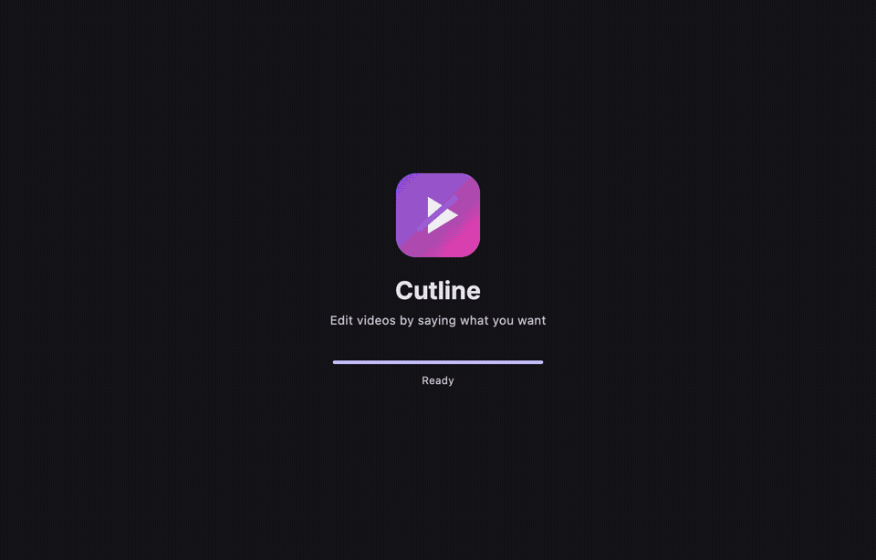
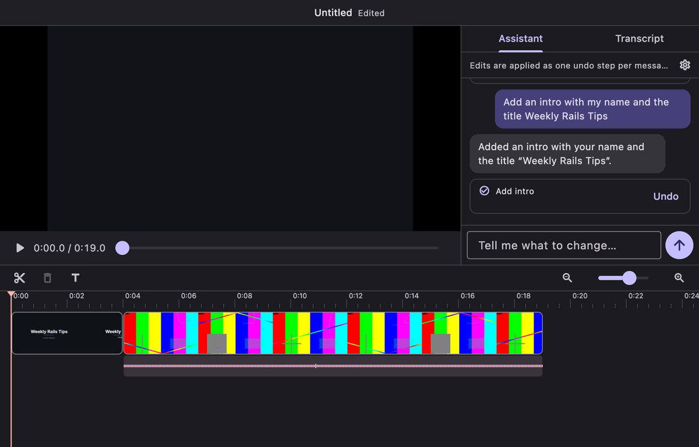
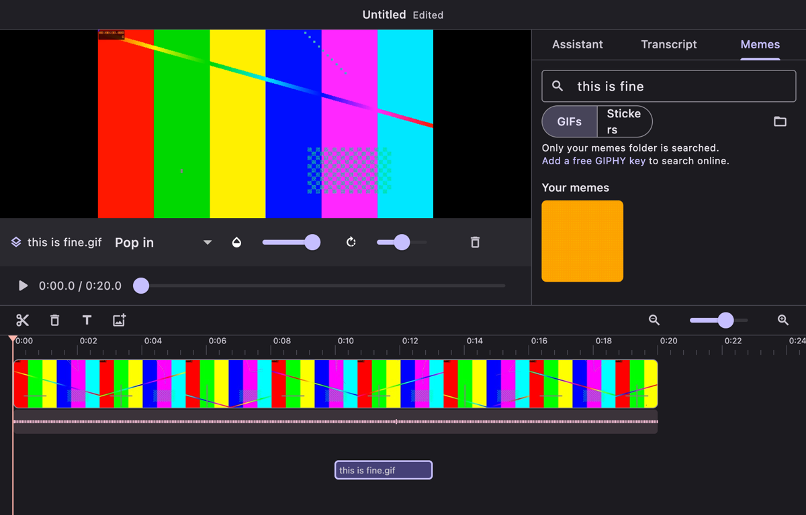
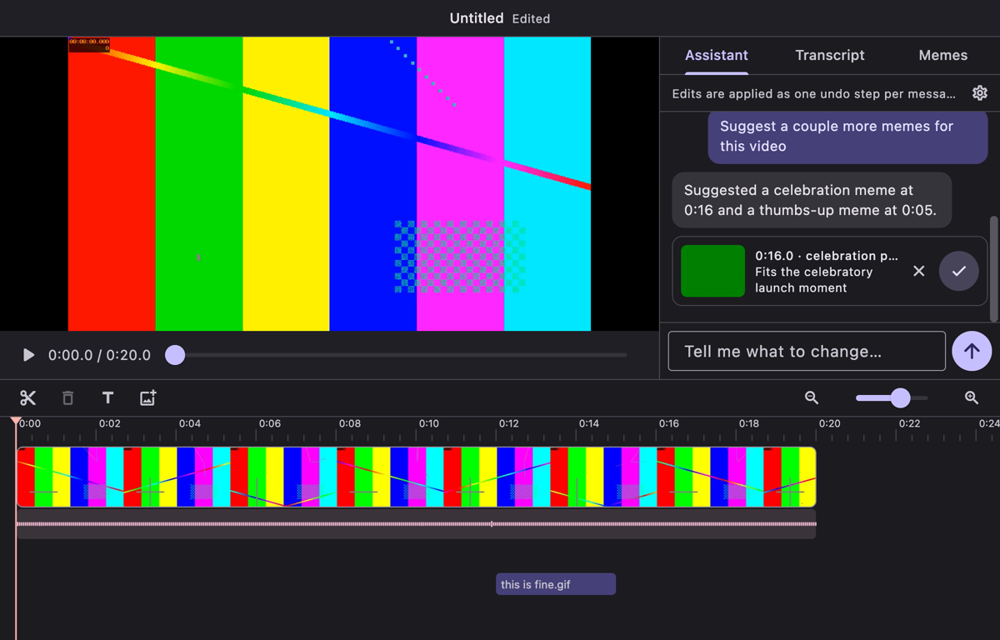
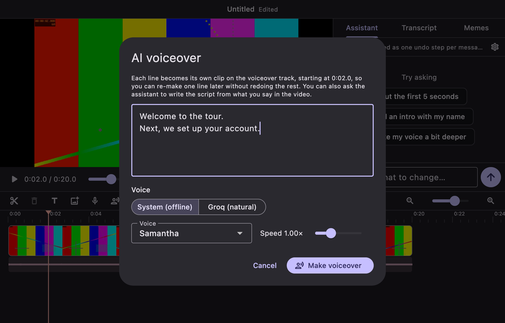

<p align="center"></p>

# Cutline

A video editor for macOS and Windows (iOS planned) where you describe the edit and the app does it. One Flutter codebase.

Tell it "add an intro with my name and the title *Weekly Rails Tips*", "put the 'this is fine' meme where I talk about deadlines", or "lower my voice a little", and Cutline turns that into real edits on the timeline. Every change the AI makes is a normal edit: you can see it, tweak it in the inspector, or undo it.

<p align="center"></p>

## What it does

- **Edit by chatting:** cut parts, keep a range, split, move and delete clips. The assistant finds moments by what you say in the video.
- **Transcripts on your computer:** whisper.cpp, with word timings.
- **Intros and titles:** four templates with your name, title, colours and fonts, before the video or over it.
- **Memes, GIFs, stickers and pictures** on top of the video: drag to place and resize, with pop, fade and slide animations. Search GIPHY or your own memes folder, or ask the assistant to add or suggest them.
- **Voiceovers:** record one from your microphone, or write a script and have it spoken (system voices, Groq's natural voices, or ElevenLabs' lifelike voices with your key). The video's sound dips while you talk.
- **Voice effects:** pitch, speed, robot, noise cleanup and even loudness, from the inspector or chat.
- **Export to MP4** with FFmpeg, using the hardware encoder when there is one.

| | |
|---|---|
|  |  |
|  |  |

## Install

Download the latest DMG (macOS) or installer (Windows) from [Releases](../../releases).

- **macOS:** open the DMG and drag Cutline to Applications.
- **Windows:** run `Cutline-…-windows-setup.exe`. It installs for your user, so you don't need admin rights.

On first launch a short guide helps you:
1. add a free [Groq](https://console.groq.com/keys) key for the assistant (or use Claude with your own key);
2. download the speech model (148 MB, once);
3. try an edit on a sample video.

See [**Getting and adding API keys**](docs/API_KEYS.md) for step-by-step instructions on every key (AI providers, GIPHY, ElevenLabs) and how to add them in Settings.

Until the builds are signed (see below), macOS says the app is from an unidentified developer: right-click Cutline → Open the first time. On Windows, SmartScreen shows "More info → Run anyway".

## Stack

- Flutter (Dart), one codebase for macOS, Windows and iOS
- media_kit for playback, FFmpeg for export
- AI that turns instructions into edits through tools: Groq's free tier (gpt-oss-120b) by default, or Claude
- whisper.cpp for on-device transcription with word timestamps (CLI, bundled)

## Development

You need Flutter 3.47 or newer, and Xcode for the macOS build (Visual Studio with the C++ workload on Windows).

The app ships two helper tools: an LGPL FFmpeg (export, thumbnails) and whisper.cpp (transcripts). Make them once before building the app:

```sh
tool/build_ffmpeg_macos.sh && tool/build_whisper_macos.sh    # macOS, needs Xcode, nasm, cmake
pwsh tool/fetch_ffmpeg_windows.ps1; pwsh tool/fetch_whisper_windows.ps1   # Windows
```

While developing, Homebrew's `ffmpeg` and `whisper-cpp` also work if the bundled ones aren't built.

```sh
flutter pub get
flutter run -d macos        # or -d windows
flutter test                # unit and widget tests
tool/screenshots.sh         # integration tests on macOS, saves screenshots to ./screenshots
```

## Releasing

Push a tag like `v1.0.0`. The [Release workflow](.github/workflows/release.yml) builds a universal macOS DMG and a Windows installer and attaches them to a GitHub release. Run it by hand to build both without publishing.

Locally:

```sh
tool/package_macos.sh           # build/dist/Cutline-<version>-macos.dmg
pwsh tool/package_windows.ps1   # build\dist\Cutline-<version>-windows-setup.exe (needs Inno Setup)
tool/make_icons.sh              # redraw the app icons from the logo
```

Signing is switched on by secrets, so nothing changes in the code:

- **macOS:** add `MACOS_CERT_P12` (a base64 Developer ID Application certificate), `MACOS_CERT_PASSWORD` and `MACOS_CODESIGN_IDENTITY`. For notarization, also add `NOTARY_APPLE_ID`, `NOTARY_TEAM_ID` and `NOTARY_PASSWORD` (an app-specific password). These need a paid Apple Developer account.
- **Windows:** add `WINDOWS_CERT_PFX` (a base64 code signing certificate) and `WINDOWS_CERT_PASSWORD`.

## Licences

Cutline bundles FFmpeg built as LGPL 2.1 (no GPL or non-free parts; see `tool/build_ffmpeg_macos.sh`), whisper.cpp (MIT) and three fonts under the SIL Open Font License. Their licence texts are in the app under About → View licenses.
